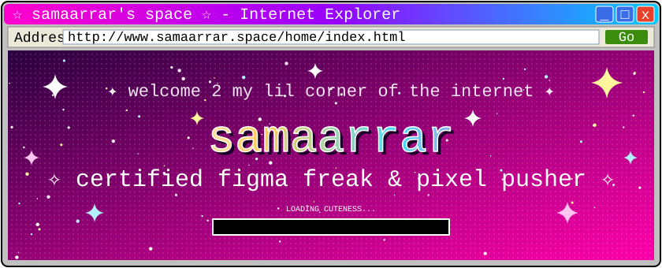
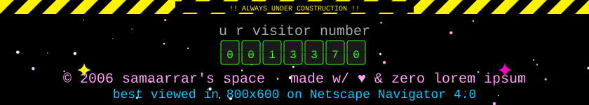

I'm a product designer who cares about the details people feel but rarely notice: clear hierarchy, honest spacing, and interfaces that just make sense. Most of my work happens in Figma, where I take ideas from rough flows to polished, developer-ready designs.

### What I work on

- **Product and UI design**, from early wireframes to high-fidelity screens
- **Design systems** with tokens, variables, components and documentation
- **Interactive prototypes** for usability testing and stakeholder reviews
- **Developer handoff** with clean specs, so what ships matches what was designed

### Toolkit

### Selected work

<table>
<tr>
<td width="33%" valign="top">

 <b><a href="https://github.com/samaarrar">Project one</a></b> 
A short line about the problem and what you designed
</td>
<td width="33%" valign="top">

 <b><a href="https://github.com/samaarrar">Project two</a></b> 
A design system, case study, or app redesign
</td>
<td width="33%" valign="top">

 <b><a href="https://github.com/samaarrar">Project three</a></b> 
A Figma Community file, plugin, or side project
</td>
</tr>
</table>

### Right now

I'm building out a component library with variables and modes, and learning front-end development to work more closely with engineers.

### Get in touch

[Portfolio](https://github.com/samaarrar) · [LinkedIn](https://linkedin.com/in/samaarrar) · [Figma Community](https://figma.com/@samaarrar) · [Email](mailto:hello@example.com)

